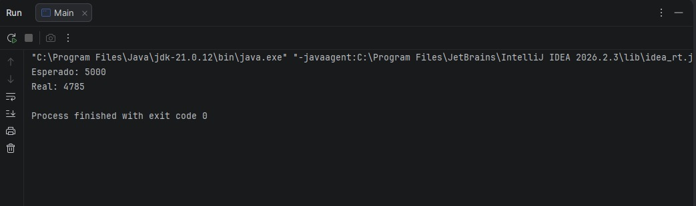
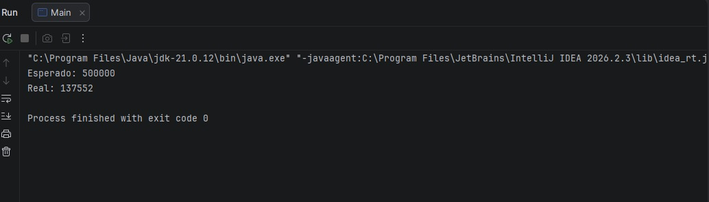
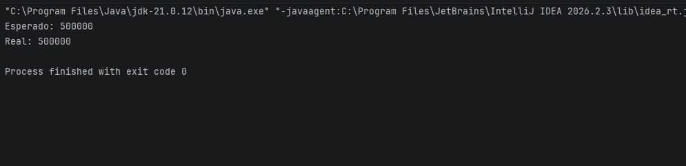
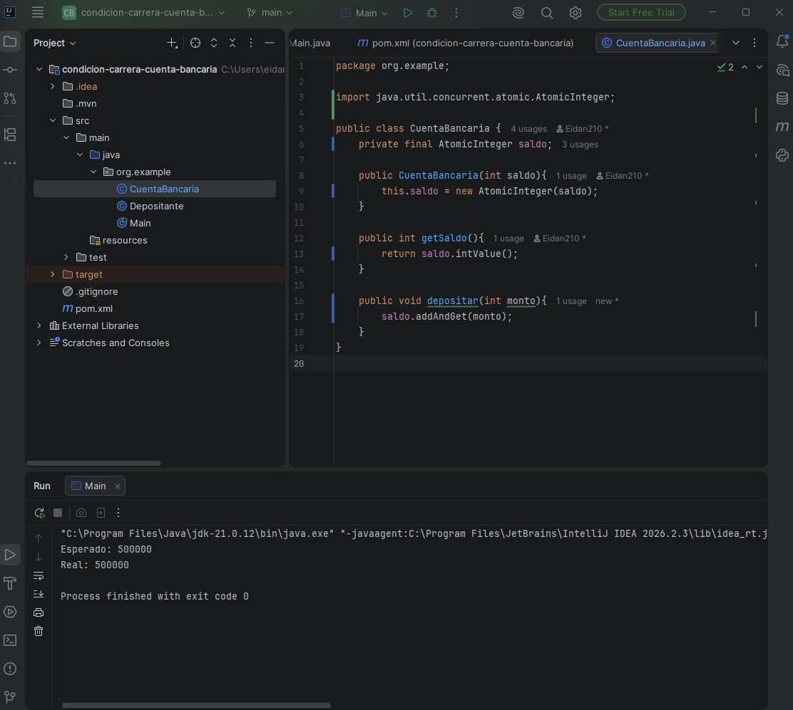

# Condición de carrera en Java: cuenta bancaria con hilos

Proyecto de práctica de **concurrencia en Java**. Primero se provoca una condición de carrera con una cuenta bancaria compartida por 5 hilos, y luego se corrige de dos formas: con `synchronized` y con `AtomicInteger`.

## El problema

5 hilos (`Runnable` + `join`) depositan 1 unidad cada vez en **la misma cuenta**, repitiéndolo muchas veces. Si todo funcionara bien, el saldo final sería:

> 5 hilos × cantidad de depósitos × monto 1

El método que falla es este:

```java
public void depositar(int monto){
    saldo += monto;
}
```

`saldo += monto` parece una sola operación, pero son tres pasos: **leer** el saldo, **sumar** el monto y **escribir** el resultado. Si dos hilos leen el mismo valor a la vez, ambos escriben el mismo resultado y **se pierde un depósito**. Java no lanza ninguna excepción: el programa termina normal con un saldo equivocado.

## Evidencia de la condición de carrera

Con 1000 depósitos por hilo, el resultado cambia en cada ejecución (4999, 5000, 4785...):



Con 100.000 depósitos por hilo el error es enorme: de 500.000 esperados, solo se registraron 137.552.



## Solución 1: `synchronized`

```java
public synchronized void depositar(int monto){
    saldo += monto;
}
```

El método queda protegido con un candado: solo un hilo a la vez puede ejecutarlo y los demás esperan su turno. Resultado, de forma consistente:



## Solución 2: `AtomicInteger`

```java
private final AtomicInteger saldo;

public CuentaBancaria(int saldo){
    this.saldo = new AtomicInteger(saldo);
}

public void depositar(int monto){
    saldo.addAndGet(monto);
}
```

`addAndGet` hace "leer, sumar y escribir" como **una sola operación indivisible** (usa compare-and-swap del procesador). Si otro hilo cambia el valor justo en medio, la operación se reintenta sola. Resultado:



## Comparación

| | `synchronized` | `AtomicInteger` |
|---|---|---|
| Cómo evita el error | Un hilo a la vez; los demás esperan | Los hilos intentan a la vez y reintentan si chocan |
| Bloquea hilos | Sí | No |
| Conviene para | Proteger varias operaciones relacionadas | Contadores y valores simples |

## Estructura del proyecto

```
src/main/java/org/example/
├── CuentaBancaria.java   # saldo compartido y método depositar
├── Depositante.java      # Runnable: deposita 100.000 veces
└── Main.java             # crea 5 hilos, start(), join() y compara esperado vs real
```

## Cómo ejecutarlo

Requisitos: **Java 21** y **Maven**.

1. Clona el repositorio:
   ```
   git clone https://github.com/Eidan210/condicion-de-carrera-java.git
   ```
2. Abre el proyecto en IntelliJ IDEA (o cualquier IDE con soporte Maven).
3. Ejecuta `Main`. Se imprimen el saldo esperado y el saldo real.

## Historial de commits

El historial muestra el recorrido del taller: versión con el error, corrección con `synchronized` y reemplazo por `AtomicInteger`.

## Qué aprendí

- Una condición de carrera no da error ni excepción: el programa termina bien con un resultado equivocado.
- Es intermitente: una ejecución correcta no prueba que el código sea seguro, por eso hay que probar con mucha carga y varias veces.
- `synchronized` y `AtomicInteger` resuelven el problema de formas distintas, y cada uno conviene según el caso.
